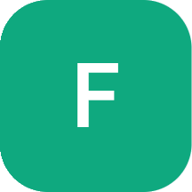
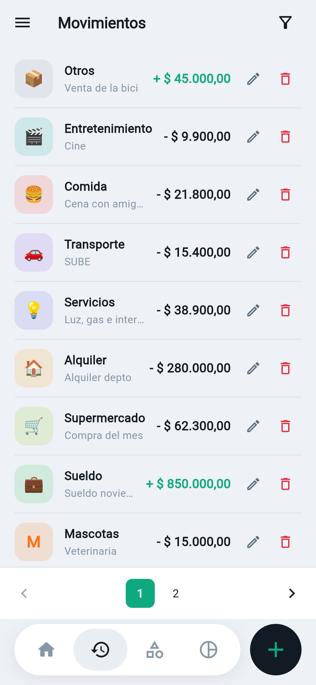
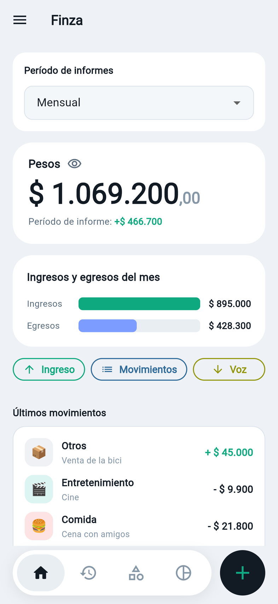
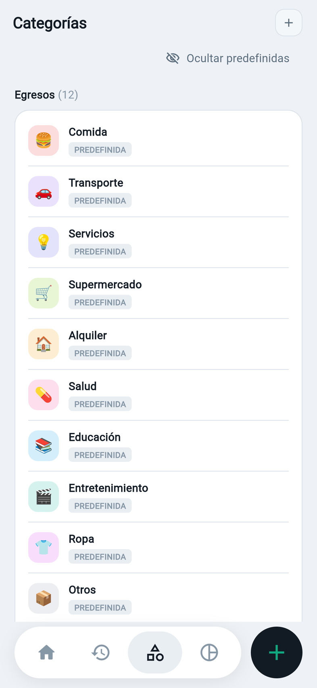

<div align="center">



# Finza

**Tus finanzas personales y las de tu casa, en una sola app.**

Anotá ingresos y gastos a mano, por voz o importados de Mercado Pago. Ordenalos en categorías, armá presupuestos por mes y mirá en qué se va la plata. Compartí una cuenta con las personas con las que vivís y cada una carga lo suyo.

[](https://github.com/Jjonathanpp/Finza/actions/workflows/ci.yml)
[](https://github.com/Jjonathanpp/Finza/releases/latest)
[](https://github.com/Jjonathanpp/Finza/stargazers)
[](https://flutter.dev)
[](https://spring.io/projects/spring-boot)
[](https://www.postgresql.org)

<a href="https://github.com/Jjonathanpp/Finza/releases/latest"></a>

<br><br>

<table>
  <tr>
    <td align="center"></td>
    <td align="center"></td>
    <td align="center"></td>
  </tr>
  <tr>
    <td align="center"><b>Historial</b></td>
    <td align="center"><b>Inicio</b></td>
    <td align="center"><b>Categorías</b></td>
  </tr>
</table>

</div>

---

## Contenido

- [Qué hace la app](#qué-hace-la-app)
- [Cómo está hecha](#cómo-está-hecha)
- [Qué hay en el repo](#qué-hay-en-el-repo)
- [Levantar el proyecto en tu compu](#levantar-el-proyecto-en-tu-compu)
- [La base de datos y las migraciones](#la-base-de-datos-y-las-migraciones)
- [Del cambio a producción (CI/CD)](#del-cambio-a-producción-cicd)
- [Problemas comunes](#problemas-comunes)
- [Equipo](#equipo)

**Guías rápidas:** [Instalar la app](#instalar-la-app) · [Correr todo con Docker](#levantar-el-proyecto-en-tu-compu) · [Crear una migración](#la-base-de-datos-y-las-migraciones) · [Si el CI queda en rojo](#si-un-control-queda-en-rojo) · [Publicar una versión](#publicar-una-versión-de-la-app-apk)

## Qué hace la app

| Función | Qué hace |
|---|---|
| **Movimientos** | Ingresos y gastos cargados a mano o dictados por voz: Gemini saca del audio el monto, la categoría, la descripción y la fecha. Se pueden editar, borrar y filtrar en el historial. |
| **Mercado Pago** | Vinculás tu cuenta y los movimientos se importan solos, también en las cuentas compartidas. |
| **Categorías** | Trae 13 categorías listas (Comida, Alquiler, Sueldo...) y podés crear las tuyas. Las predefinidas que no usás se pueden ocultar. |
| **Presupuestos** | Un tope por categoría y por mes. La app avisa a medida que te acercás al tope y cuando lo pasás. |
| **Inicio e informes** | El saldo, lo que entró y salió en el período y los últimos movimientos. Los montos se pueden ocultar con un toque. |
| **Cuentas compartidas** | Invitás por mail a quienes viven con vos. Cada uno carga sus gastos y todos ven los de la casa. |
| **Perfiles** | Una misma cuenta puede tener varios perfiles. |
| **Actualizaciones** | Cuando sale una versión nueva, la app avisa al abrirla y lleva directo a la descarga. |

### Instalar la app

1. Bajá el archivo `finza-x.y.z.apk` de la [última versión](https://github.com/Jjonathanpp/Finza/releases/latest).
2. Abrilo en el celular. Si Android lo pide, permití instalar apps de esa fuente.
3. Las versiones nuevas se instalan encima y no se pierde nada.

## Cómo está hecha

| Parte | Tecnología | Dónde corre en producción |
|---|---|---|
| App | Flutter (Dart) | En el celular. La APK se publica en GitHub Releases |
| Backend | Spring Boot 4.1 con Java 17 | Render, con Docker |
| Base de datos | PostgreSQL 16, versionada con Flyway | Neon |

## Qué hay en el repo

```
Finza/
├── backend/                  API REST en Spring Boot
│   ├── Dockerfile            con esto arma la imagen Render y también el Docker local
│   └── src/main/resources/
│       ├── application*.properties      configuración general y perfiles docker y prod
│       └── db/
│           ├── migration/    migraciones de Flyway: estructura y catálogo (V1, V2, V3...)
│           └── datos-prueba/ datos de prueba, solo para el Docker local
├── frontend/                 la app en Flutter
├── testing/                  pruebas de Cucumber (no corren en el CI)
├── documentos/capturas/      el logo y las capturas de este README
├── .github/workflows/
│   ├── ci.yml                controles de cada PR y de cada push a main
│   └── publicar-apk.yml      arma, firma y publica la APK
├── docker-compose.yml        base, backend y Cucumber para trabajar en la compu
└── .env.example              variables para copiar a .env
```

## Levantar el proyecto en tu compu

Hace falta Docker con Docker Compose. Para la app, Flutter 3.44.9 (la misma versión que usa el CI). Java y Maven no hacen falta: Docker compila el backend.

1. Copiá las variables y completá `JWT_SECRET` con cualquier texto de 32 caracteres o más. Sin eso el backend no arranca. Las claves de Gemini y Brevo son opcionales en local.

   ```bash
   cp .env.example .env
   ```

2. Levantá todo:

   ```bash
   docker compose up --build
   ```

   Arrancan tres contenedores. `finza-db` es PostgreSQL en el puerto 5432 (usuario, clave y base: `finza`). `finza-app` es el backend en http://localhost:8080; está listo cuando http://localhost:8080/api/health responde. `finza-test` corre una vez las pruebas de Cucumber y termina.

   La primera vez Flyway arma la base de cero y carga el catálogo de categorías y los datos de prueba (usuarios, cuentas y movimientos de ejemplo).

3. Corré la app:

   ```bash
   cd frontend
   flutter pub get
   flutter run
   ```

   Por defecto la app le habla a `http://localhost:8080`. En el emulador de Android ese `localhost` es el emulador mismo, así que hay que pasarle la dirección de la compu:

   ```bash
   flutter run --dart-define=API_URL=http://10.0.2.2:8080
   ```

Comandos que se usan seguido:

| Para | Comando |
|---|---|
| Levantar en segundo plano | `docker compose up -d --build` |
| Ver los logs del backend | `docker compose logs -f app` |
| Recompilar solo el backend | `docker compose up -d --build app` |
| Apagar y conservar la base | `docker compose down` |
| Apagar y borrar la base | `docker compose down -v` |

## La base de datos y las migraciones

La estructura de la base la maneja Flyway. Cada cambio es un archivo SQL numerado en `backend/src/main/resources/db/migration`, y cada base guarda en la tabla `flyway_schema_history` cuáles ya corrieron. Al arrancar, el backend compara esa tabla con la carpeta y corre en orden los archivos que faltan. Hibernate está en `ddl-auto=validate`: no toca la base, solo controla que coincida con las entidades. Si falta una tabla o una columna, el backend no arranca.

| Archivo | Qué hace |
|---|---|
| `V1__esquema_inicial.sql` | Todas las tablas, como estaban cuando se pasó a Flyway |
| `V2__add_importado_por_to_movimientos.sql` | La columna `importado_por` en `movimiento` |
| `V3__catalogo_de_categorias.sql` | Las 13 categorías predefinidas |
| `db/datos-prueba/R__datos_de_prueba.sql` | Datos de prueba. Solo en el Docker local |

Reglas para trabajar con migraciones:

- Un cambio de estructura (tabla, columna, tipo, índice) lleva una migración nueva con el número siguiente: `V4__descripcion.sql`, `V5__...`. Una entidad o columna sin su migración hace que el backend no arranque.
- Una migración que ya está en `main` no se edita. Flyway guarda una huella (checksum) de cada archivo y, si cambia, no arranca. Un error se corrige con una migración nueva.
- Dos migraciones con el mismo número rompen el arranque. Antes de crear una, hacé pull de `main` para ver el último número y avisá en el grupo cuál tomás. Si dos ramas chocan, quien mergea segundo renombra la suya al siguiente libre.
- Para agregar o cambiar una categoría del catálogo también se hace una migración nueva.

Los datos de prueba son una migración repetible (`R__`). No llevan número, corren después de todas las versiones y vuelven a correr solo cuando cambia el archivo. Como están en una carpeta aparte que solo lee el perfil `docker`, nunca llegan a producción. Si los cambiás, cuidá que sigan sin duplicar filas (`ON CONFLICT DO NOTHING`).

En producción la base ya existía antes de Flyway, así que está marcada como que ya tiene la V1 (`baseline-on-migrate`). Ahí corren solo la V2 y las siguientes.

## Del cambio a producción (CI/CD)

```
rama ──► PR a main ──► CI: backend + frontend ──► merge ──► CI en main ──► Render despliega el backend
                                                                     └──► (a mano) Publicar APK
```

1. Trabajás en tu rama y abrís un PR a `main`.
2. El CI (`.github/workflows/ci.yml`) corre dos controles a la vez. `backend` compila con `mvn -B -ntp verify`. `frontend` corre `flutter analyze` y `flutter test`. Si pusheás de nuevo al PR, la corrida vieja se cancela y arranca otra.
3. `main` está protegida: GitHub no deja mergear hasta que los dos controles estén en verde.
4. Al mergear, el CI vuelve a correr sobre `main`. Cuando queda en verde, Render despliega el backend solo. Si el merge no tocó nada de `backend/`, Render no hace nada.
5. La app no se publica sola. Cuando quieran sacar una versión, siguen los pasos de [Publicar una versión de la app](#publicar-una-versión-de-la-app-apk).

### Si un control queda en rojo

En el PR, la pestaña Checks muestra qué control falló; entrando al control se ve el paso en rojo y su log. Para reproducirlo en tu compu (el del backend necesita Java 17):

```bash
# backend
cd backend && ./mvnw -B verify

# frontend
cd frontend && flutter analyze && flutter test
```

Lo arreglás, pusheás a la misma rama y el CI corre de nuevo.

Si los controles quedan en "Expected — Waiting for status to be reported", el CI no arrancó. Pasa a veces cuando GitHub tiene problemas (se puede ver en https://www.githubstatus.com). Cerrá el PR y volvé a abrirlo para que arranque. No uses la opción de saltear las reglas para mergear: Render solo despliega commits con el CI en verde.

### El backend en Render

El servicio `finza-backend` arma la imagen con `backend/Dockerfile` (Root Directory `backend/`) y la arranca con el perfil `prod`. El Auto-Deploy está en "After CI Checks Pass". El progreso de cada deploy se ve en Events. Si un deploy falla, sigue andando la versión anterior; en Logs está el motivo, que suele ser una migración con error o una columna sin migración.

El plan gratis duerme el backend cuando no se usa, así que el primer pedido después de un rato tarda unos 40 segundos.

Variables que lee el backend en producción (se cargan en Render, en Environment):

| Variable | Para qué |
|---|---|
| `SPRING_PROFILES_ACTIVE=prod` | Activa `application-prod.properties` |
| `SPRING_DATASOURCE_URL`, `SPRING_DATASOURCE_USERNAME`, `SPRING_DATASOURCE_PASSWORD` | Conexión a Neon |
| `JWT_SECRET` | Firma de las sesiones |
| `MP_CLIENT_ID`, `MP_CLIENT_SECRET`, `MP_REDIRECT_URI`, `MP_WEBHOOK_SECRET` | Conexión con Mercado Pago |
| `MP_CRYPTO_SECRET` | Cifrado de los tokens de Mercado Pago. Sin ella el backend no arranca |
| `BREVO_API_KEY`, `BREVO_SENDER_EMAIL` | Envío de correos |
| `GEMINI_API_KEY` | Gemini |

### Publicar una versión de la app (APK)

GitHub arma y publica la APK, firmada siempre con la misma clave. Si la firma cambiara, Android no instalaría la versión nueva encima de la vieja. La clave está en los secrets del repo, así que nadie la necesita en su compu.

1. La versión no se sube a mano. El workflow la calcula a partir de la última release publicada, según el tipo que elijas al correrlo: arreglo (1.1.3 → 1.1.4) o novedad (1.1.3 → 1.2.0).
2. Para probar: GitHub → Actions → Publicar APK → Run workflow, sobre `main`, con el tipo elegido y "Solo probar" marcado. Si todo pasa, la APK queda para bajar en la sección Artifacts de la corrida.
3. Para publicar: lo mismo con "Solo probar" desmarcado. Se crean el tag (por ejemplo `v1.1.4`) y la release con `finza-1.1.4.apk`, marcada como la última. Quien tenga una versión anterior ve un aviso para bajarla al abrir la app.

El workflow se frena si fallan `flutter analyze` o `flutter test`, o si la APK no salió firmada con la clave de Finza. La APK siempre apunta al backend de producción.

Las releases se hacen solo con este workflow. Una creada a mano desde la web desordena la cuenta de versiones y, si no tiene APK, la app deja de avisar.

## Problemas comunes

| Error | Qué pasa y qué hacer |
|---|---|
| `Found non-empty schema(s) public but no schema history table` | Tu base local es de antes de Flyway. Recreala una vez con `docker compose down -v` y `docker compose up --build` |
| `Schema-validation: missing table` o `missing column` | Hay una entidad o columna sin migración. Agregá una migración nueva |
| `Migration checksum mismatch` | Alguien editó una migración que ya corrió. Volvé el archivo a como estaba y hacé el cambio en una migración nueva |
| `Found more than one migration with version` | Dos migraciones con el mismo número. Renombrá la tuya al siguiente libre |
| `Could not resolve placeholder 'JWT_SECRET'` | Falta `JWT_SECRET` en `.env` |
| El puerto 8080 o 5432 está ocupado | Cambiá `APP_PORT` o `DB_PORT` en `.env` |

## Equipo

Finza la hacemos cuatro estudiantes como proyecto de la facultad. Las tareas se organizan por sprints en OpenProject.

<a href="https://github.com/Jjonathanpp/Finza/graphs/contributors">
  
</a>
